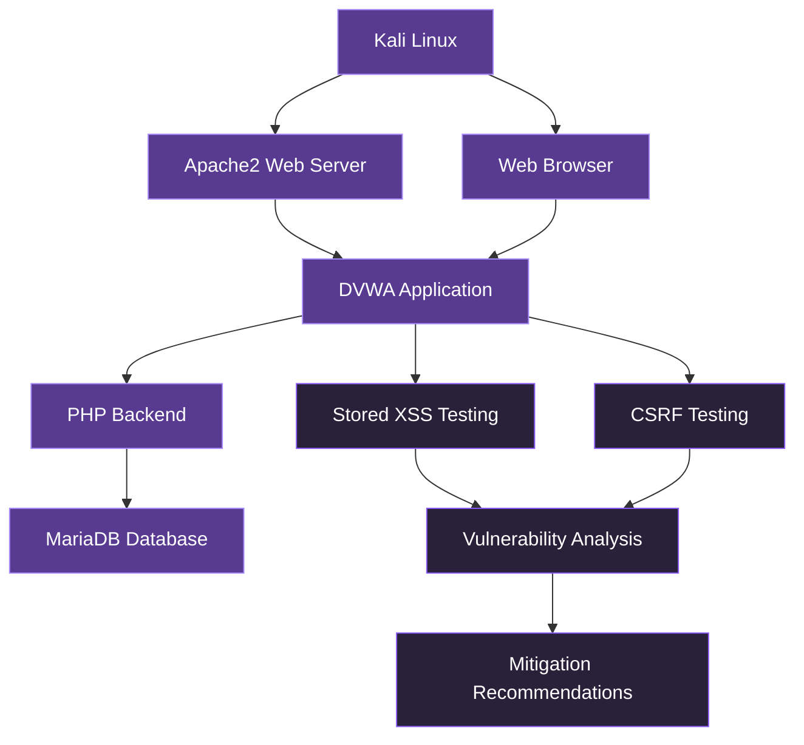
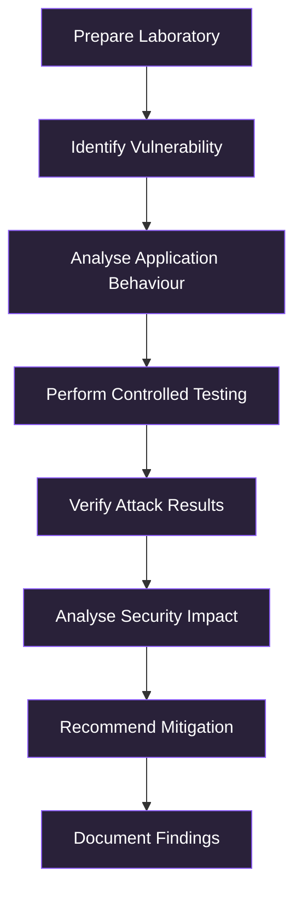
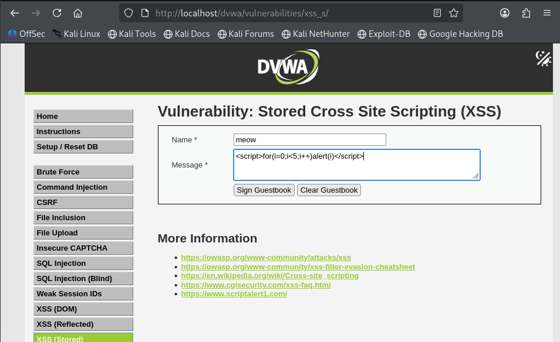
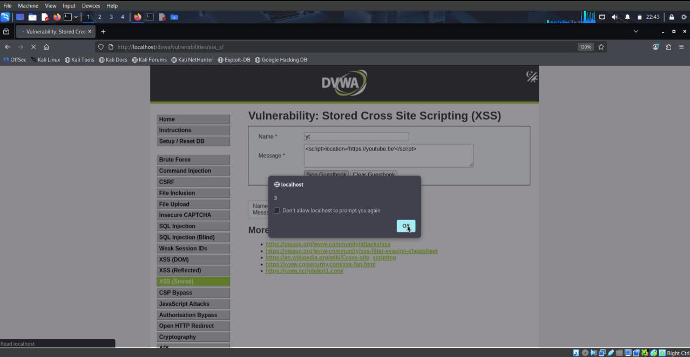
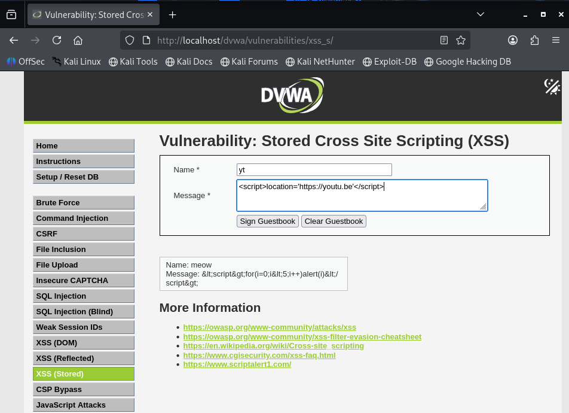
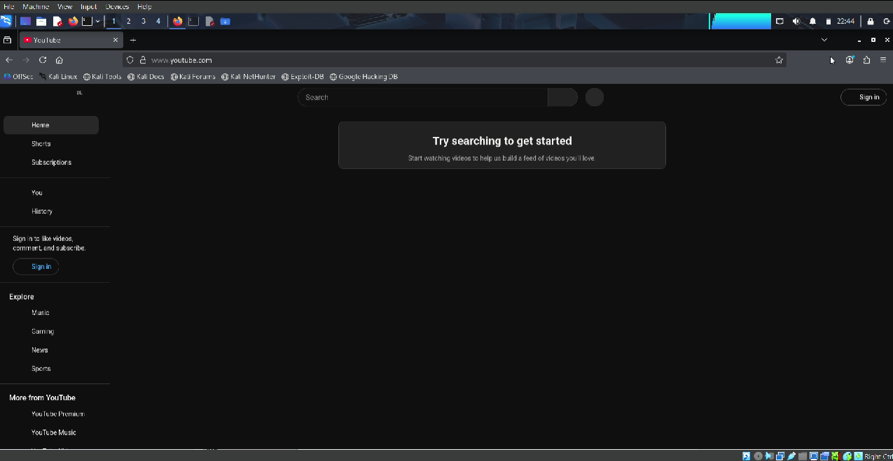
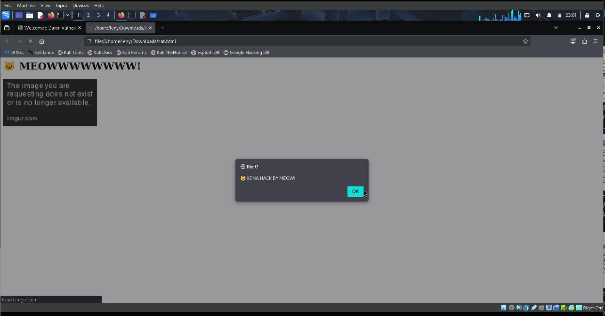
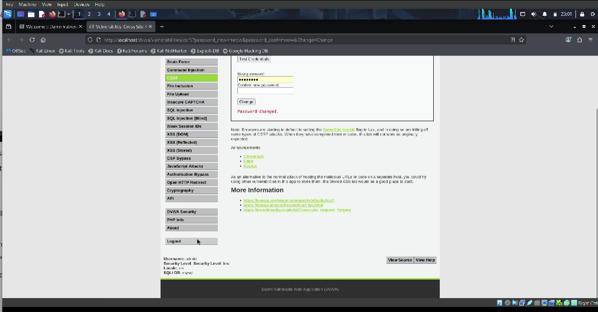
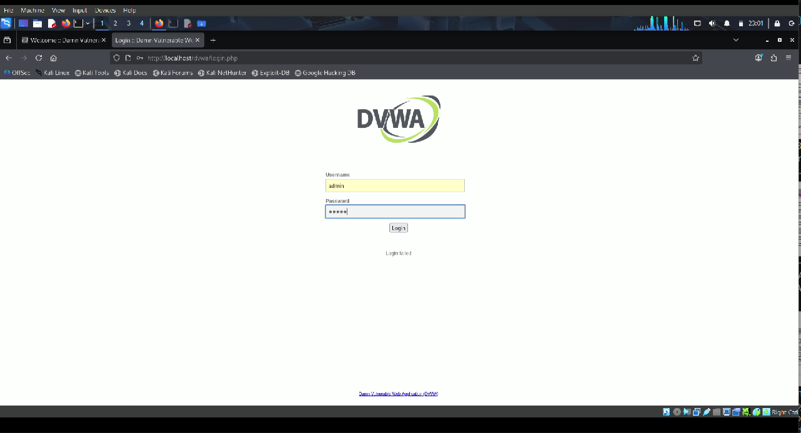
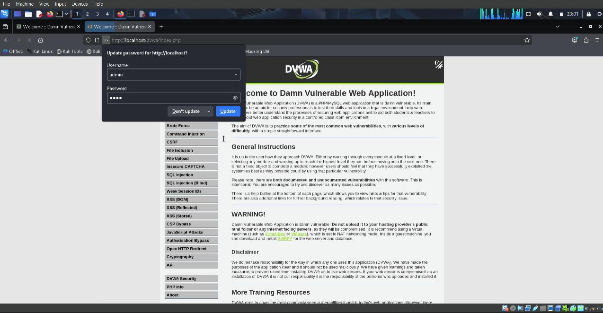

<div align="center">


*Identify. Exploit. Analyse. Secure.*

</div>

---

## 01 / Project Overview

An academic web application penetration testing project conducted using Damn Vulnerable Web Application (DVWA) within a controlled Kali Linux laboratory environment.

The project focused on identifying, exploiting and analysing two common web application vulnerabilities: Stored Cross-Site Scripting (XSS) and Cross-Site Request Forgery (CSRF).

Practical demonstrations were conducted to understand the behaviour, security impact and root causes of these vulnerabilities, followed by documentation of recommended mitigation techniques.

| Information | Details |
| --- | --- |
| Project Type | Individual Academic Project |
| Course | ITT557 - Web Application Security |
| Domain | Cybersecurity & Web Penetration Testing |
| Target Application | DVWA |
| Operating System | Kali Linux |
| Security Level | Low |
| Vulnerabilities Tested | Stored XSS and CSRF |
| Testing Environment | Local Laboratory |
| Status | Completed |

## 02 / Project Objectives

- Establish a local web application penetration testing environment.
- Identify common web application vulnerabilities.
- Demonstrate persistent JavaScript execution through Stored XSS.
- Demonstrate browser redirection through Stored XSS.
- Demonstrate unauthorized password modification through CSRF.
- Verify and document vulnerability testing results.
- Understand vulnerability root causes and security impacts.
- Recommend appropriate secure coding practices.

## 03 / Laboratory Architecture



The laboratory environment was hosted locally to allow controlled vulnerability testing without affecting external systems.

## 04 / Tools & Technologies

| Technology | Purpose |
| --- | --- |
| Kali Linux | Penetration testing operating system |
| DVWA | Intentionally vulnerable web application |
| Apache2 | Local web server |
| MariaDB | Database management |
| PHP | Server-side application processing |
| JavaScript | Client-side vulnerability demonstrations |
| HTML | Custom CSRF demonstration page |
| Git | DVWA installation and source retrieval |
| Web Browser | Vulnerability testing and verification |

## 05 / Laboratory Environment Setup

The DVWA laboratory was configured through the following process:

1. Updated the Kali Linux environment.
2. Installed Apache2, MariaDB, PHP and required dependencies.
3. Started and enabled the necessary services.
4. Downloaded DVWA from its official GitHub repository.
5. Created a dedicated DVWA database and database user.
6. Configured the application database connection.
7. Initialized the DVWA database.
8. Accessed DVWA through the local web browser.
9. Configured the DVWA security level to Low.

The environment was intentionally configured with weak security controls to support educational vulnerability testing.

## 06 / Penetration Testing Methodology



The testing process focused on understanding application behaviour, reproducing vulnerabilities and documenting observable results.

## 07 / Stored Cross-Site Scripting (XSS)

### Vulnerability Overview

Stored Cross-Site Scripting occurs when untrusted input is stored by a web application and subsequently rendered without appropriate security controls.

When another user accesses the affected page, the stored JavaScript may execute within their browser.

| Information | Details |
| --- | --- |
| Vulnerability | Stored Cross-Site Scripting |
| Classification | CWE-79 |
| Attack Surface | User input form |
| Attack Type | Client-side script injection |
| Persistence | Stored application data |
| Testing Result | Successfully demonstrated |

### Testing Activities

- Submitted JavaScript through a vulnerable input form.
- Demonstrated multiple browser alert messages.
- Reloaded the affected page to verify persistent execution.
- Demonstrated browser redirection.
- Analysed the application's handling of untrusted input.

### Practical Demonstration

#### JavaScript Payload Injection



*Figure 1: JavaScript payload injection through a vulnerable input form.*

#### Persistent JavaScript Execution



*Figure 2: Browser alert demonstrating stored JavaScript execution.*

#### Browser Redirection



*Figure 3: Injection of a browser redirection payload.*



*Figure 4: Successful browser redirection in the testing environment.*

### Root Cause Analysis

- Insufficient handling of untrusted user input.
- Direct rendering of stored content.
- Missing context-appropriate output encoding.
- Insufficient protection against executable content.

### Potential Security Impact

- Session compromise.
- Account impersonation.
- Website defacement.
- Unauthorized browser redirection.
- Exposure of sensitive user information.

These impacts represent potential consequences of Stored XSS. The practical demonstration focused on JavaScript execution and browser redirection.

## 08 / Cross-Site Request Forgery (CSRF)

### Vulnerability Overview

Cross-Site Request Forgery occurs when an authenticated user's browser is manipulated into performing an unintended action within a trusted web application.

The vulnerability exploits the application's trust in authenticated browser requests.

| Information | Details |
| --- | --- |
| Vulnerability | Cross-Site Request Forgery |
| Classification | CWE-352 |
| Attack Surface | Password change functionality |
| Attack Type | Unauthorized authenticated request |
| Testing Requirement | Active authenticated session |
| Testing Result | Successfully demonstrated |

### Testing Activities

- Developed a custom HTML demonstration page named `cat.html`.
- Used an existing authenticated DVWA session.
- Demonstrated an unintended password change.
- Logged out of the application.
- Verified the password modification through authentication.

### Practical Demonstration

#### CSRF Demonstration Page



*Figure 5: Custom HTML page developed to demonstrate CSRF.*

#### Unauthorized Password Change



*Figure 6: Password change demonstration within the DVWA laboratory.*

#### Attack Verification



*Figure 7: Login verification using the modified password.*



*Figure 8: Successful authentication confirming the attack result.*

### Root Cause Analysis

- Missing anti-CSRF tokens in the tested functionality.
- Insufficient request origin verification.
- Reliance on an existing authenticated session.
- Missing re-authentication for sensitive account changes.

### Potential Security Impact

- Unauthorized password modification.
- Unauthorized account changes.
- Manipulation of application data.
- Unintended transactions.
- Loss of account integrity.

The practical demonstration focused on unauthorized password modification within the local laboratory.

## 09 / Vulnerability Testing Results

| Test Case | Expected Result | Observed Result | Status |
| --- | --- | --- | --- |
| Stored XSS Injection | Application stores injected input | Input successfully stored | Passed |
| JavaScript Execution | Browser executes stored script | Alert messages displayed | Passed |
| XSS Persistence | Script executes after page reload | Persistent execution observed | Passed |
| Browser Redirection | Browser redirects to another page | Redirection observed | Passed |
| CSRF Password Change | Password modification occurs | Password successfully modified | Passed |
| Authentication Verification | Modified password allows login | Successful authentication | Passed |

The results confirmed the presence of Stored XSS and CSRF vulnerabilities under the tested DVWA security configuration.

## 10 / Vulnerability Mitigation

### Stored XSS Mitigation

| Security Control | Purpose |
| --- | --- |
| Input Validation | Restrict input to expected formats |
| Output Encoding | Prevent untrusted data from executing as code |
| HTML Sanitization | Remove unsafe markup when HTML input is permitted |
| Content Security Policy | Provide an additional browser-level security layer |
| Secure Cookie Attributes | Reduce certain session-related risks |
| Secure Coding Practices | Prevent unsafe handling and rendering of untrusted content |

### CSRF Mitigation

| Security Control | Purpose |
| --- | --- |
| Anti-CSRF Tokens | Validate legitimate application requests |
| SameSite Cookies | Restrict certain cross-site cookie usage |
| Origin Verification | Validate the source of sensitive requests |
| Re-authentication | Require identity confirmation for sensitive operations |
| Secure HTTP Methods | Avoid GET requests for state-changing operations |
| Server-side Validation | Verify authorization and request integrity |

These controls were documented as mitigation recommendations. Their implementation and effectiveness were not independently tested during this project.

## 11 / Project Outcomes

- Established a functional DVWA laboratory on Kali Linux.
- Configured Apache2, MariaDB and PHP services.
- Successfully demonstrated Stored XSS.
- Verified persistent JavaScript execution.
- Demonstrated browser redirection.
- Successfully demonstrated CSRF-based password modification.
- Verified vulnerability testing results.
- Analysed vulnerability root causes and potential security impacts.
- Documented recommended mitigation techniques.
- Produced technical documentation and practical testing evidence.

## 12 / Technical Skills Developed

- Web application penetration testing
- Vulnerability identification
- Vulnerability exploitation in controlled environments
- Cross-Site Scripting (XSS) analysis
- Cross-Site Request Forgery (CSRF) analysis
- Linux system administration
- Apache web server configuration
- MariaDB database configuration
- JavaScript and HTML analysis
- Web application security
- Authentication and session security
- Secure coding fundamentals
- Security testing documentation
- Vulnerability assessment and reporting

## 13 / Repository Structure

```text
dvwa-web-penetration-testing/
├── README.md
├── documentation/
│   ├── lab-setup.md
│   └── mitigation.md
└── screenshots/
    ├── README.md
    ├── stored-xss-input.png
    ├── stored-xss-alert.png
    ├── stored-xss-redirect-input.png
    ├── stored-xss-redirect-result.png
    ├── csrf-demo-page.png
    ├── csrf-password-change-result.png
    ├── csrf-login-verification.png
    └── csrf-authenticated-result.png
```

### Additional Documentation

- [Laboratory Setup](./documentation/lab-setup.md)
- [Vulnerability Mitigation Recommendations](./documentation/mitigation.md)
- [Practical Testing Screenshots](./screenshots/)

## 14 / Future Improvements

- [ ] Test additional DVWA security levels.
- [ ] Perform SQL injection testing.
- [ ] Perform command injection testing.
- [ ] Explore reflected and DOM-based XSS.
- [ ] Integrate Burp Suite into the testing workflow.
- [ ] Implement vulnerability mitigation in a separate test application.
- [ ] Conduct post-mitigation security testing.
- [ ] Develop structured vulnerability assessment reports.
- [ ] Integrate web application testing into a cybersecurity home lab.

## 15 / Learning Resources

- [Official DVWA Repository](https://github.com/digininja/DVWA)
- [OWASP Top 10](https://owasp.org/www-project-top-ten/)
- [OWASP Web Security Testing Guide](https://owasp.org/www-project-web-security-testing-guide/)
- [OWASP XSS Prevention Cheat Sheet](https://cheatsheetseries.owasp.org/cheatsheets/Cross_Site_Scripting_Prevention_Cheat_Sheet.html)
- [OWASP CSRF Prevention Cheat Sheet](https://cheatsheetseries.owasp.org/cheatsheets/Cross-Site_Request_Forgery_Prevention_Cheat_Sheet.html)
- [CWE-79: Cross-Site Scripting](https://cwe.mitre.org/data/definitions/79.html)
- [CWE-352: Cross-Site Request Forgery](https://cwe.mitre.org/data/definitions/352.html)

## 16 / Disclaimer

This project was conducted strictly for academic and educational purposes within an authorized, controlled local laboratory environment.

DVWA is an intentionally vulnerable application designed for cybersecurity education and practical security testing.

The screenshots and documentation presented in this repository demonstrate my academic vulnerability testing activities.

---

<div align="center">

*Explore. Learn. Secure. Repeat.*

[GitHub Profile](https://github.com/rosinss)


</div>
