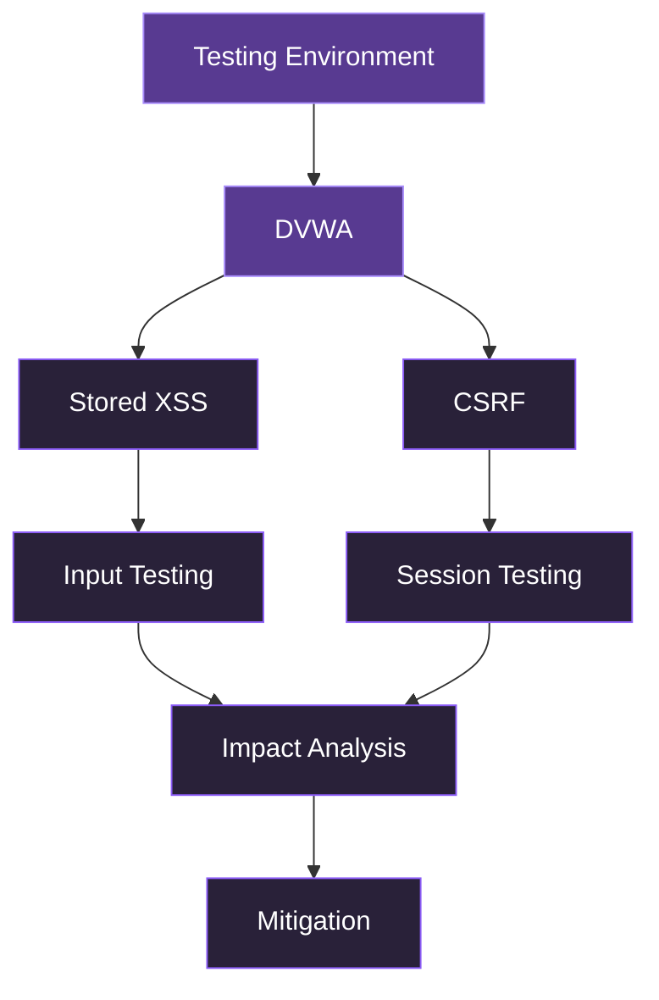
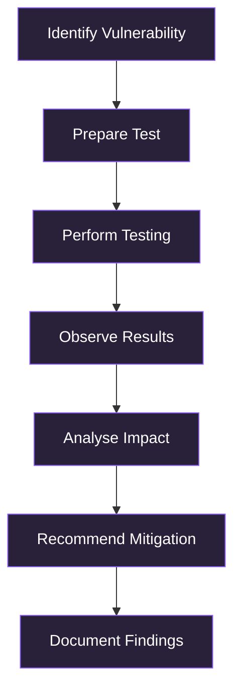

*Identify. Analyse. Test. Secure.*

---

## 01 / Project Overview

A practical web application security assessment conducted using Damn Vulnerable Web Application (DVWA) to investigate common web vulnerabilities, demonstrate their security impacts and identify appropriate mitigation strategies.

This individual academic project focused on Stored Cross-Site Scripting (XSS) and Cross-Site Request Forgery (CSRF) within a controlled testing environment.

## 02 / Project Objectives

- Identify common web application vulnerabilities.
- Perform practical vulnerability testing.
- Understand insecure input handling.
- Investigate browser and session-based security weaknesses.
- Evaluate potential security impacts.
- Recommend appropriate mitigation strategies.

## 03 / Testing Architecture

## 04 / Tools & Technologies

| Technology | Purpose |
| --- | --- |
| DVWA | Vulnerable web application testing environment |
| JavaScript | Client-side vulnerability demonstrations |
| HTML | Request forgery demonstration |
| Web Browser | Application testing and observation |
| HTTP | Request and response analysis |
| OWASP | Web security guidance |

## 05 / Vulnerability Assessment

### Stored Cross-Site Scripting (XSS)

Stored XSS occurs when untrusted user input is stored by a web application and subsequently executed as browser-side code.

#### Practical Testing

- Investigated vulnerable message input fields.
- Demonstrated persistent JavaScript injection.
- Observed repeated script execution after page reload.
- Analysed insufficient input validation and output encoding.
- Evaluated the security implications of persistent script execution.

#### Potential Security Impacts

- Session hijacking
- Website defacement
- Unauthorized browser redirection
- Sensitive information exposure
- Account impersonation

### Cross-Site Request Forgery (CSRF)

CSRF exploits the trust between an authenticated user's browser and a web application to perform unintended actions.

#### Practical Testing

- Developed an HTML-based proof of concept.
- Investigated authenticated browser behaviour.
- Demonstrated an unauthorized password change in DVWA.
- Identified missing request verification mechanisms.
- Analysed weaknesses in session-based authentication.

#### Potential Security Impacts

- Unauthorized password changes
- Account modification
- Unauthorized transactions
- Data manipulation
- Loss of account integrity

## 06 / Vulnerability Testing Results

| Security Test | Result |
| --- | --- |
| Stored XSS | Successfully demonstrated |
| Persistent JavaScript Execution | Confirmed |
| Script Execution After Reload | Confirmed |
| CSRF | Successfully demonstrated |
| Unauthorized Password Change | Confirmed |
| Mitigation Strategies | Documented |

## 07 / Root Cause Analysis

| Vulnerability | Root Cause |
| --- | --- |
| Stored XSS | Insufficient input validation and output encoding |
| CSRF | Missing anti-CSRF tokens and request verification |
| Insecure Request Handling | Insufficient verification of sensitive actions |
| Persistent Script Execution | Untrusted content rendered without proper encoding |

## 08 / Recommended Security Controls

### XSS Prevention

- Context-aware output encoding
- Input validation
- HTML sanitization
- Content Security Policy (CSP)
- Secure cookie attributes

### CSRF Prevention

- Anti-CSRF tokens
- SameSite cookie attributes
- Origin verification
- User re-authentication for sensitive operations
- Appropriate HTTP request methods

These security controls were identified as mitigation recommendations.

## 09 / Security Assessment Methodology

## 10 / Technical Skills Developed

- Web Application Penetration Testing
- Vulnerability Assessment
- Cross-Site Scripting (XSS)
- Cross-Site Request Forgery (CSRF)
- HTTP Request Analysis
- Browser Security
- Session Security
- Secure Coding Principles
- Security Risk Analysis
- Technical Documentation

## 11 / Future Improvements

- [ ] SQL Injection testing
- [ ] DOM-based XSS testing
- [ ] Reflected XSS testing
- [ ] Authentication security testing
- [ ] Burp Suite integration
- [ ] Implementation of mitigation controls
- [ ] Security regression testing
- [ ] OWASP Top 10 vulnerability coverage

## 12 / Disclaimer

This project was conducted exclusively for academic and educational purposes. All vulnerability testing was performed within an intentionally vulnerable and authorized environment.

---

*Explore. Learn. Secure. Repeat.*

[GitHub Profile](https://github.com/rosinss)

